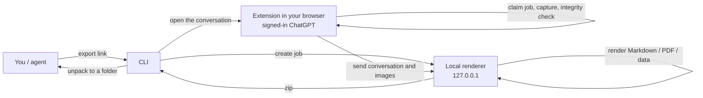

<p align="center">
  
</p>

<p align="center">
  <a href="https://github.com/amethyst-cosmos/convo-vault/actions/workflows/ci.yml"></a>
  <a href="https://github.com/amethyst-cosmos/convo-vault/releases/latest"></a>
  <a href="LICENSE"></a>
  
  
  
</p>

<p align="center">
  English · <a href="README.zh-CN.md">简体中文</a>
</p>

<p align="center">
  <a href="#quick-start">Quick start</a> ·
  <a href="#what-you-get">What you get</a> ·
  <a href="#how-it-compares">How it compares</a> ·
  <a href="#cli">CLI</a> ·
  <a href="#privacy-and-security">Privacy</a> ·
  <a href="CHANGELOG.md">Changelog</a>
</p>

Current version: `0.10.3`

**Convo Vault turns a ChatGPT conversation into a folder you own.** Tell Claude or Codex to export a conversation, or send it a screenshot, and you get typeset Markdown and PDF plus structured data you can feed to agents, a knowledge base or a RAG pipeline: JSONL messages, QA pairs, a topic and entity index, and the model's full thinking and tool trace.

Everything runs on your machine. The extension reads the ChatGPT tab you are already signed in to, and a small local service renders the files. No cloud converter, and no cookies or tokens handed to an agent.

<p align="center">
  
</p>

## Why Convo Vault

<table>
  <tr>
    <td width="33%" valign="top">
      <h3>Agent-native</h3>
      A skill for Claude Code and Codex, an MCP server for chat apps, and a CLI. Paste a link or a screenshot; the agent installs, exports and reports. No panel to click, no mode to pick.
    </td>
    <td width="33%" valign="top">
      <h3>Nothing silently lost</h3>
      Every export is checked message by message against ChatGPT's own message list. A gap blocks the export and tells you what is missing. Images, citations, thinking steps and generative UI are kept.
    </td>
    <td width="33%" valign="top">
      <h3>Local by design</h3>
      The renderer listens on <code>127.0.0.1</code> only, jobs can only be claimed by the extension, and your login stays in the browser. Files never leave the machine.
    </td>
  </tr>
</table>

## Quick start

### 1. Let an agent install it

In Claude Code, the Code tab of the Claude desktop app, or Codex, send:

```text
Install https://github.com/amethyst-cosmos/convo-vault for me. Follow INSTALL.md in the repository and put it in ~/convo-vault.
```

The agent clones the repository, installs dependencies, builds the extension, installs the skill and runs a check.

### 2. Load the extension once

This is the only manual step, because browsers do not let programs install unpublished extensions:

1. Open the extensions page (`chrome://extensions` or `edge://extensions`) and turn on **Developer mode**.
2. Click **Load unpacked** and choose `~/convo-vault/dist/convo-vault-extension`.
3. Sign in to ChatGPT in that browser.

### 3. Use it

Start a new agent session and say:

> Export this conversation: https://chatgpt.com/c/xxxxxxxx-xxxx-xxxx-xxxx-xxxxxxxxxxxx

Or send a screenshot of the conversation and say "download this whole conversation". The agent reads the link from the address bar. The folder appears in `~/Downloads/convo-vault/`.

<details>
<summary><b>Prefer to install it yourself?</b></summary>

<br>

Download `convo-vault-<version>.zip` from [Releases](https://github.com/amethyst-cosmos/convo-vault/releases) and unzip it, or clone the repository, then:

```bash
node scripts/convo-vault.mjs setup     # install dependencies, build the extension, install the skill
node scripts/convo-vault.mjs verify    # after loading the extension: confirm the browser answers
```

Requires Node 20 or newer.

</details>

### Where it works

| Environment | Works | How |
| --- | :---: | --- |
| Claude Code, the Code tab of the Claude desktop app, Codex | ✅ | Skill, installed by `setup` |
| Claude desktop chat, Cursor and other clients with local MCP | ✅ | `node scripts/convo-vault.mjs mcp install`, then send a link or screenshot in chat |
| claude.ai and chatgpt.com in the browser (including ChatGPT agent mode) | ❌ | They run in a cloud sandbox and cannot reach your browser or local services |

## What you get

Each export is a folder (and a `.zip`), including a PDF that reads like the ChatGPT page.

<table>
  <tr>
    <td valign="top" width="58%">

| File | Contents |
| --- | --- |
| `*.md` | Readable Markdown with clickable citation footnotes |
| `*.pdf` | Typeset PDF; formulas, Mermaid, charts and generative UI drawn statically |
| `*.summary.md` | Summary index |
| `*.messages.jsonl` | One message per line, ready for search and RAG |
| `*.qa-pairs.json` | Question and answer pairs |
| `*.topics.json`, `*.entities.json` | Topic index; links, file names, dates |
| `*.agent-trace.json` | Full thinking and tool trace per answer, in order, with complete tool outputs and a source index |
| `*.agent-trace.md` | Readable version of the trace |
| `*.assets.manifest.json` | Where every image and attachment came from, how it is stored, why it degraded |
| `*.payload.json`, `*.conversation.json`, `*.data.json` | Complete export data and metadata, enough to re-render later |

</td>
    <td valign="top" width="42%" align="center">
      <br>
      <sub>PDF output: formulas, Mermaid diagrams and charts, rendered from the test fixtures</sub>
    </td>
  </tr>
</table>

## How it compares

Convo Vault is young. This is how it sits next to the established options, taken from each project's public README or site in October 2026. Corrections are welcome.

| | **Convo Vault** | [pionxzh/chatgpt-exporter](https://github.com/pionxzh/chatgpt-exporter) | [ChatGPT Exporter](https://www.chatgptexporter.com/) (Chrome extension) | OpenAI data export + converters such as [convoviz](https://github.com/mohamed-chs/convoviz) |
| --- | --- | --- | --- | --- |
| Runs | Local extension and local renderer | Tampermonkey userscript | Chrome extension; PDF is generated on the vendor's servers, per its site | OpenAI emails a zip; converters run locally |
| Formats | Markdown, PDF, JSONL, QA pairs, topics, entities, asset manifest | Text, PNG, Markdown, HTML, JSON | PDF, Markdown, TXT, JSON, CSV, image | Raw JSON; Markdown, charts and word clouds from convoviz |
| Thinking and tool trace | ✅ Ordered, with full tool output | Not listed in its README | Not listed on its site | Not listed in convoviz's README |
| Completeness check | ✅ Against ChatGPT's message list; blocks on gaps | Not listed | Not listed | n/a |
| Agent, CLI and MCP | ✅ Skill, CLI, MCP server | Not listed | Not listed | CLI only |
| Export all conversations | ❌ Not yet | ✅ Export All | Not listed | ✅ Whole history |
| Install | Releases or `git clone`; load unpacked once | Tampermonkey and a userscript | Chrome Web Store | No install, or `pip` / `uv` |
| Maturity | New | 2.8k stars, active since December 2022 | "80,000+ users" (self-reported) | Established |

If you need to archive your whole history today, use one of the others. If you want complete, agent-ready exports of the conversations that matter, with the thinking trace, and a way to ask an agent to do it, that is what Convo Vault is for.

## How it works



- The CLI creates a job on the local renderer, then opens `chatgpt.com/c/<id>#convo-vault-job=<job id>`.
- The extension claims the job, captures the conversation with the session already in your browser, passes the integrity check, hands the data to the renderer, and closes the tab.
- If the capture is incomplete the job fails and says what is missing. Nothing partial is exported silently.
- The renderer started for the CLI exits two minutes after its last request.

## CLI

```bash
node scripts/convo-vault.mjs export https://chatgpt.com/c/<id>        # a link or a conversation id
node scripts/convo-vault.mjs export <link> --out ./archive            # choose where to save
node scripts/convo-vault.mjs export <link> --mode hybrid              # fast (default) | hybrid | full
node scripts/convo-vault.mjs export <link> --no-pdf                   # data only: faster, no headless Chrome
node scripts/convo-vault.mjs export <link> --browser "Microsoft Edge"
```

| Command | What it does |
| --- | --- |
| `setup` | Install dependencies, build the extension, install the skill |
| `verify` | Confirm the extension in your browser answers |
| `doctor` | Check dependencies, extension build, browsers and skills |
| `update` | Pull the latest version and reinstall (git checkouts) |
| `skill install` | Reinstall the Claude and Codex skills |
| `mcp install` / `mcp config` | Add the MCP server to Claude desktop; print config for other clients |
| `backend start` / `stop` / `status` | The local renderer; it starts on demand and exits when idle |

Other options: `--no-extract` keeps only the zip, `--keep-tab` leaves the tab open, `--allow-incomplete` exports a capture that failed the integrity check (refused by default). The first export tries each installed Chrome, Edge and Brave and remembers the one with the extension.

## Capture modes

| Mode | Source | Use it for |
| --- | --- | --- |
| **Fast** (default) | ChatGPT's conversation API: messages, order, images, thinking, citations, generated files. Not affected by virtual scrolling; long conversations take seconds | Everyday archiving |
| **Hybrid** | Fast first, then Full fills in details that only exist on the page, merged by message id | Page-only details |
| **Full** | Scrolls the page and reads the DOM; takes minutes | When the API is unavailable |

All three modes build the expected message list from the API and check the result against it by message id. A mismatch is reported as incomplete and blocks the export.

## Using the panel by hand

To export only some messages you can skip the agent: open a ChatGPT conversation, click the Convo Vault icon, choose **Open Selector**, pick a mode, **Start Scan**, review the integrity report, then export. The panel needs the renderer running: `node scripts/convo-vault.mjs backend start`, or **Copy Start** in the popup.

<table>
  <tr>
    <td align="center" width="50%">
      <br>
      <sub>The popup: open the selector, check the renderer</sub>
    </td>
    <td align="center" width="50%">
      <br>
      <sub>Pick messages, read the integrity report, export</sub>
    </td>
  </tr>
</table>

<details>
<summary>More panel screenshots</summary>

<br>

<p align="center"></p>
<p align="center"></p>
<p align="center"></p>
<p align="center"></p>
<p align="center"></p>

</details>

## Privacy and security

- The extension reads only the ChatGPT page you have open. No remote conversion service is used.
- PDF, Markdown and zip files are generated on your machine. Runtime data lives in `.convo-vault/`, which is git-ignored.
- The renderer listens on `127.0.0.1` only and requires a token. Without one, requests that carry a browser `Origin` are rejected.
- Export jobs are identified by a 192-bit random id and can be claimed once, by the extension only. The renderer's token is handed to the extension at claim time and never passes through a web page.
- Creating jobs and reading results accept only local requests without a browser `Origin`, and the `Host` header is checked, so web pages and DNS rebinding cannot drive them.
- An agent never needs, and never gets, your ChatGPT session: the extension uses the one already in your browser.

See [SECURITY.md](SECURITY.md) to report a vulnerability.

## Languages and output types

Conversation text is kept as Unicode and never translated: Chinese, English, Spanish, Italian, Japanese, Korean, Arabic, Hebrew and mixed-direction text all export correctly. The interface and documentation are in English, with a [Chinese README](README.zh-CN.md).

The PDF is the reading archive and the JSON files are the evidence archive. Formulas, Mermaid, simple charts, code, tables, images and ChatGPT's generative UI are drawn statically where possible. Video, audio and interactive cards degrade to a clear card, and the JSON records `kind`, `renderStatus`, `degraded` and the reason, so nothing disappears silently.

## Roadmap

Ideas under consideration, not promises:

- Export all conversations, with incremental sync that fetches only what changed.
- Build the bundle inside the extension so no local service is needed (PDF stays optional).
- Chrome Web Store release.
- Obsidian-friendly Markdown (frontmatter and tags).

## Development

```bash
npm test                  # all tests
npm run check             # syntax and JSON checks; verifies content.js matches src/content
npm run build:extension   # build dist/convo-vault-extension and its zip
npm run package           # build dist/convo-vault-<version>.zip
```

- `content.js` is generated from `src/content/index.js` and its modules. Run `npm run build:extension` after editing `src/content`.
- Releases: bump the version, merge, then push a `v<version>` tag. GitHub Actions checks, tests, packages and publishes the release.
- Keep the version in sync across `package.json`, `manifest.json`, `tools/advanced-pdf/package.json`, `src/content/index.js`, `popup.html`, both READMEs and both changelogs. `tests/version.test.mjs` enforces it.

See [CONTRIBUTING.md](CONTRIBUTING.md) for more.

## License

[MIT](LICENSE)
