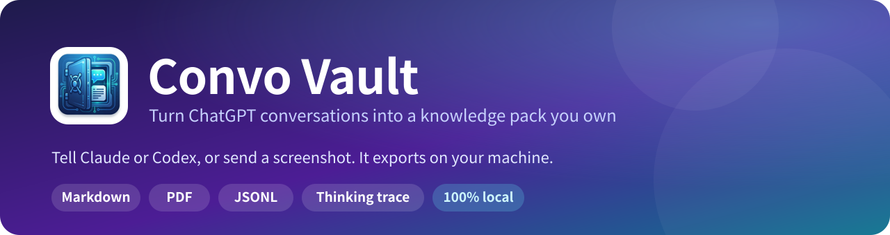
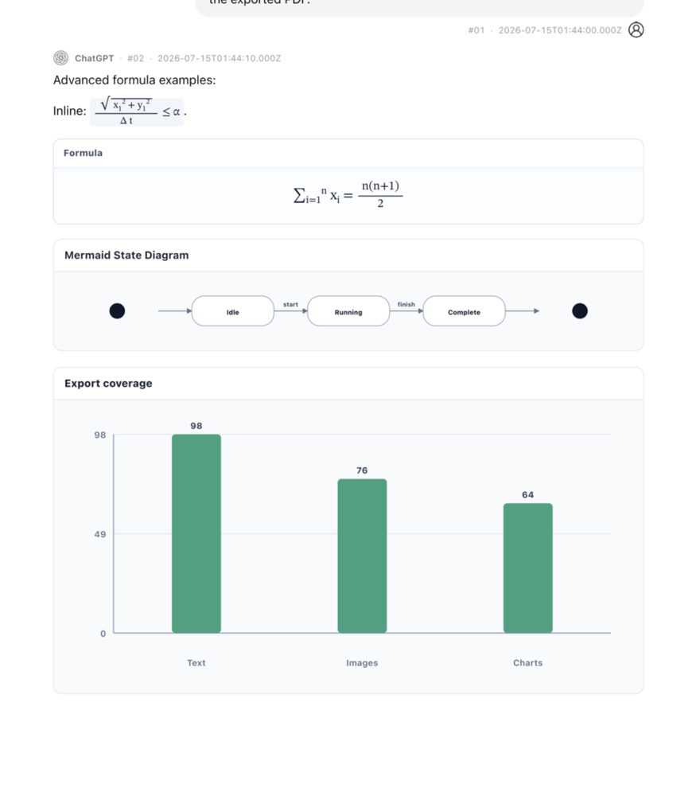
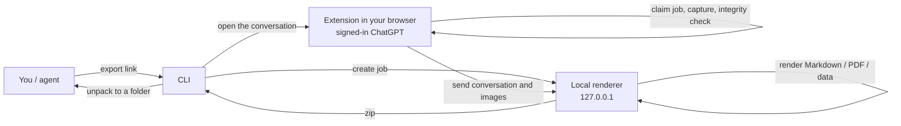

<p align="center">
  
</p>

<p align="center">
  <a href="https://github.com/amethyst-cosmos/convo-vault/actions/workflows/ci.yml"></a>
  <a href="https://github.com/amethyst-cosmos/convo-vault/releases/latest"></a>
  <a href="LICENSE"></a>
  
  
  
</p>

<p align="center">
  English · <a href="README.zh-CN.md">简体中文</a>
</p>

<p align="center">
  <a href="#quick-start">Quick start</a> ·
  <a href="#what-you-get">What you get</a> ·
  <a href="#cli">CLI</a> ·
  <a href="#privacy-and-security">Privacy</a> ·
  <a href="CHANGELOG.md">Changelog</a>
</p>

Current version: `0.14.0`

**Convo Vault turns a ChatGPT conversation into a folder you own.** Tell Claude or Codex to export a conversation, or send it a screenshot, and you get typeset Markdown and PDF plus structured data you can feed to agents, a knowledge base or a RAG pipeline: JSONL messages, QA pairs, a topic and entity index, and the model's full thinking and tool trace.

Everything runs on your machine. The extension reads the ChatGPT tab you are already signed in to, and a small local service renders the files. No cloud converter, and no cookies or tokens handed to an agent.

<p align="center">
  
</p>

## Why Convo Vault

<table>
  <tr>
    <td width="33%" valign="top">
      <h3>Agent-native</h3>
      A skill for Claude Code and Codex, an MCP server for chat apps, and a CLI. Paste a link or a screenshot; the agent installs, exports and reports. No panel to click, no mode to pick.
    </td>
    <td width="33%" valign="top">
      <h3>Nothing silently lost</h3>
      Every export is checked message by message against ChatGPT's own message list. A gap blocks the export and tells you what is missing. Images, citations, thinking steps and generative UI are kept.
    </td>
    <td width="33%" valign="top">
      <h3>Local by design</h3>
      The renderer listens on <code>127.0.0.1</code> only, jobs can only be claimed by the extension, and your login stays in the browser. Files never leave the machine.
    </td>
  </tr>
</table>

## Quick start

### 1. Let an agent install it

In Claude Code, the Code tab of the Claude desktop app, or Codex, send:

```text
Install https://github.com/amethyst-cosmos/convo-vault for me. Follow INSTALL.md in the repository and put it in ~/convo-vault.
```

The agent clones the repository, installs dependencies, builds the extension, installs the skill and runs a check.

### 2. Load the extension once

This is the only manual step, because browsers do not let programs install unpublished extensions:

1. Open the extensions page (`chrome://extensions` or `edge://extensions`) and turn on **Developer mode**.
2. Click **Load unpacked** and choose `~/convo-vault/dist/convo-vault-extension`.
3. Sign in to ChatGPT in that browser.

### 3. Use it

Start a new agent session and say:

> Export this conversation: https://chatgpt.com/c/xxxxxxxx-xxxx-xxxx-xxxx-xxxxxxxxxxxx

Or send a screenshot of the conversation and say "download this whole conversation". The agent reads the link from the address bar. The folder appears in `~/Downloads/convo-vault/`.

<details>
<summary><b>Prefer to install it yourself?</b></summary>

<br>

Download `convo-vault-<version>.zip` from [Releases](https://github.com/amethyst-cosmos/convo-vault/releases) and unzip it, or clone the repository, then:

```bash
node cli/convo-vault.mjs setup     # install dependencies, build the extension, install the skill
node cli/convo-vault.mjs verify    # after loading the extension: confirm the browser answers
```

Requires Node 20 or newer.

</details>

### Where it works

| Environment | Works | How |
| --- | :---: | --- |
| Claude Code, the Code tab of the Claude desktop app, Codex | ✅ | Skill, installed by `setup` |
| Claude desktop chat, Cursor and other clients with local MCP | ✅ | `node cli/convo-vault.mjs mcp install`, then send a link or screenshot in chat |
| claude.ai and chatgpt.com in the browser (including ChatGPT agent mode) | ❌ | They run in a cloud sandbox and cannot reach your browser or local services |

The skill is the self-contained folder `skills/convo-vault-skill`. Copy it anywhere, or run `node cli/convo-vault.mjs skill install --dir <folder>`. Its launcher finds the project, or installs it from GitHub the first time.

### Also on Agensi

The same skill is listed, free, on [Agensi](https://www.agensi.io/skills/convo-vault-chatgpt-exporter), a marketplace that serves skills to your agent over MCP. It is a text-only version (`skills/convo-vault-agensi`): on first use the agent asks your permission, installs this project from GitHub into `~/convo-vault`, and you load the extension once. It is the same open-source code either way; the Agensi listing is only another way to find it.

### Grok

Grok conversations work the same way: give the agent a `https://grok.com/c/<id>` link, or run `node cli/convo-vault.mjs export https://grok.com/c/<id>`. The extension reads Grok's own conversation API with the session your browser already has (no token, no scrolling) and checks that every message came back before it exports. The PDF and data files look the same as a ChatGPT export, labelled Grok; Grok's search steps become the thinking trace and its citations become footnotes.

Not yet for Grok: downloading attachments and generated images (they are listed as links), `list` and `--project`. A conversation with regenerated answers exports its newest branch and says how many alternatives it skipped. Links to several Grok conversations run in one grok.com tab, and a mix of ChatGPT and Grok links gets one tab per site.

### Gemini

Gemini conversations work too: give the agent a `https://gemini.google.com/app/<id>` link. Gemini has no conversation API the extension can call, so the page itself is read: the extension scrolls the conversation to the top until no older turns appear, turns each reply's HTML back into Markdown (lists, tables, code with its language, math, links) and exports the same bundle, labelled Gemini. Several Gemini links each get their own tab, one after another.

Honest limits: Gemini does not say how many messages a conversation has, so the check is only what the page shows (a reply for every prompt, nothing still being written, no turns dropped while loading) and the export says so in a warning. The collapsed thinking panel, source chips, attachments and images are not exported (images and attachment names appear as links or names where the page shows them). This is the most fragile of the three sites: a Gemini redesign can break it.

## What you get

Each export is a folder (and a `.zip`), including a PDF that reads like the ChatGPT page.

<table>
  <tr>
    <td valign="top" width="58%">

| File | Contents |
| --- | --- |
| `*.md` | Readable Markdown with clickable citation footnotes |
| `*.pdf` | Typeset PDF; formulas, Mermaid, charts and generative UI drawn statically |
| `*.summary.md` | Summary index |
| `*.messages.jsonl` | One message per line, ready for search and RAG |
| `*.qa-pairs.json` | Question and answer pairs |
| `*.topics.json`, `*.entities.json` | Topic index; links, file names, dates |
| `*.agent-trace.json` | Full thinking and tool trace per answer, in order, with complete tool outputs and a source index |
| `*.agent-trace.md` | Readable version of the trace |
| `*.assets.manifest.json` | Where every image and attachment came from, how it is stored, why it degraded; size and SHA-256 of each downloaded file |
| `assets/files/` | Only with `--files`: the Word, PDF, zip... files uploaded to or generated in the conversation |
| `*.payload.json`, `*.conversation.json`, `*.data.json` | Complete export data and metadata, enough to re-render later |

</td>
    <td valign="top" width="42%" align="center">
      <br>
      <sub>PDF output: formulas, Mermaid diagrams and charts, rendered from the test fixtures</sub>
    </td>
  </tr>
</table>

## How it works



- The CLI creates a job on the local renderer and opens the conversation with the job id in the URL. The extension claims the job, captures the conversation with the session already in your browser, passes the integrity check and hands the data to the renderer.
- If the capture is incomplete the job fails and says what is missing. The renderer started for the CLI exits two minutes after its last request.

## CLI

```bash
node cli/convo-vault.mjs export https://chatgpt.com/c/<id>        # a link or a conversation id
node cli/convo-vault.mjs export <link> --out ./archive            # choose where to save
node cli/convo-vault.mjs export <link> --no-pdf                   # data only: faster, no headless Chrome
node cli/convo-vault.mjs export <link> --files                    # also download uploaded and generated files
node cli/convo-vault.mjs export <link> --browser "Microsoft Edge"
node cli/convo-vault.mjs export <link1> <link2> <link3>           # several at once, in one browser tab
node cli/convo-vault.mjs list --project "Research"                 # see what is in a project (id, date, title)
node cli/convo-vault.mjs export --project "Research"               # every conversation in the project
node cli/convo-vault.mjs export --project "Research" --files-for "invoice,report"   # files only for those
```

Several conversations run **in one tab, one after another**, so nothing pops up per conversation (on macOS the tab also opens without bringing the browser to the front). Each result is printed, a failed conversation does not stop the rest, and the exit code is 1 if any failed. `--files-for` takes words from titles (or ids); `--files` means all.

| Command | What it does |
| --- | --- |
| `setup` | Install dependencies, build the extension, install the skill |
| `list` | List conversations (all recent ones, or `--project NAME`); `--json` for data |
| `verify` | Confirm the extension in your browser answers |
| `doctor` | Check dependencies, extension build, browsers and skills |
| `update` | Pull the latest version, reinstall and reload the extension (git checkouts) |
| `reload` | Make the extension reload itself after a rebuild |
| `skill install` | Reinstall the Claude and Codex skills |
| `mcp install` / `mcp config` | Add the MCP server to Claude desktop; print config for other clients |
| `backend start` / `stop` / `status` | The local renderer; it starts on demand and exits when idle |

Other options: `--no-extract` keeps only the zip, `--keep-tab` leaves the tab open, `--allow-incomplete` exports a capture that failed the integrity check (refused by default). The first export tries each installed Chrome, Edge and Brave and remembers the one with the extension.

## Without an agent

By default the extension is only a connector: exports are started by your agent or the command line, and the popup has nothing to click. If you would rather export by hand, click the Convo Vault icon and turn on **Manual controls**. The choice is remembered, and your agent can still start exports either way.

With manual controls on, open the ChatGPT conversation and press **Export this conversation**. It exports the whole conversation, with no selection step. The local renderer must be running: `node cli/convo-vault.mjs backend start`, or **Copy Start** in the popup.

## How it reads the conversation

Convo Vault reads ChatGPT's own conversation API, the same data the page is drawn from. It never scrolls or clicks the page, so a very long conversation takes seconds and the tab can stay in the background. The result is checked against ChatGPT's message list by message id; if anything is missing the export is blocked and says what.

You get everything the conversation has: every message, the model's thinking steps and tool calls in order with their full output, every web page it looked at and cited, images and generative UI. Uploaded and generated files are listed in the manifest and downloaded only when you ask for them (`--files`; the agent asks once, default no). Choosing what to keep is up to you afterwards.

## Privacy and security

- The extension reads only the ChatGPT page you have open. No remote conversion service is used, and files never leave your machine.
- The renderer listens on `127.0.0.1` only and requires a token.
- Export jobs use a 192-bit random id. Only local programs can create them and only the extension can claim them, once.
- An agent never needs, and never gets, your ChatGPT session: the extension uses the one already in your browser.

See [SECURITY.md](SECURITY.md) to report a vulnerability.

## Languages and output types

Conversation text is kept as Unicode and never translated, so Chinese, Japanese, Korean, Arabic, Hebrew, European languages and mixed text all export correctly. Content that cannot be drawn in the PDF (video, audio, interactive cards) becomes a clear card, and the JSON records why, so nothing disappears silently.

## Development

```bash
npm test                  # all tests
npm run check             # syntax and JSON checks, and that the content script builds
npm run build:extension   # build dist/convo-vault-extension and its zip
npm run package           # build dist/convo-vault-<version>.zip
```

- The extension is in `extension/`; its content script is generated from `extension/content/index.js` and its modules by `npm run build:extension`, which writes the loadable folder to `dist/convo-vault-extension`.
- Releases: `npm run version:set -- X.Y.Z` writes the version into every file that carries it (and adds an empty entry to both changelogs). Fill in the two changelog entries, merge, then push a `vX.Y.Z` tag. GitHub Actions checks, tests, packages and publishes the release.

See [CONTRIBUTING.md](CONTRIBUTING.md) for more.

## License

[MIT](LICENSE)
