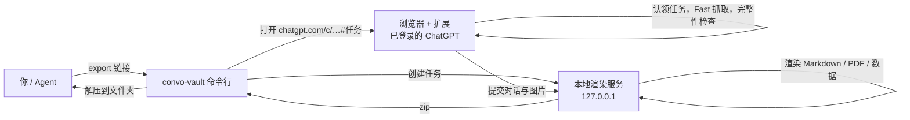

<h1 align="center">Convo Vault</h1>

<p align="center">
  <b>把 ChatGPT 对话，变成真正属于你的本地知识包。</b><br>
  对 Agent 说一句话就能导出：Markdown、PDF、结构化数据、完整思考过程，全部留在你的电脑上。
</p>

<p align="center">
  
  
  
  
  
</p>

---

当前版本：`0.10.0`

长对话里混着代码、表格、图片、文件线索和一大段思考过程，手动复制太痛苦，丢给在线转换工具又不放心。Convo Vault 是一个本地优先的 Chrome 扩展加一套命令行：它读取你已登录的 ChatGPT 对话，在本机渲染出排版精致的 Markdown 和 PDF，并生成能直接喂给 Codex、Claude、Cursor、知识库或 RAG 流程的结构化数据（JSONL、QA 对、主题图谱、实体索引、深度推理追踪）。

## 三种用法

| | 怎么做 | 适合 |
| --- | --- | --- |
| **对 Agent 说话**（推荐） | 在 Claude 或 Codex 里说“把这个对话导出来”，贴链接或直接发截图 | 日常使用，零点击 |
| **命令行** | `node scripts/convo-vault.mjs export <链接>` | 脚本、批量、定时任务 |
| **扩展面板** | 打开对话，点扩展图标，选择消息再导出 | 只想导出其中几条消息 |

## 快速开始

### 最省事：让 Agent 替你装

在 Claude Code、Claude 桌面版的 Code 标签或 Codex 里发这一句：

> 请帮我安装 https://github.com/amethyst-cosmos/convo-vault ，按仓库里的 INSTALL.md 操作，装到 ~/convo-vault。

Agent 会克隆项目、装依赖、构建扩展、安装 skill，并运行 `verify` 检查。**唯一需要你动手的是在浏览器里加载一次扩展并登录 ChatGPT**，浏览器不允许程序自动安装未上架的扩展。装完在新会话里说“导出这个对话 <链接>”即可。

### 哪些 Agent 能用

| 环境 | 能不能用 | 方式 |
| --- | --- | --- |
| Claude Code、Claude 桌面版的 Code 标签、Codex | 能 | skill |
| Claude 桌面版的普通聊天、Cursor 等支持本地 MCP 的客户端 | 能 | `mcp install`，聊天里发链接或截图 |
| claude.ai 网页、ChatGPT 网页（含它的 Agent 模式） | 不能 | 它们跑在云端沙盒，碰不到你电脑上的浏览器和本地服务 |

### 手动安装

只需要做一次。

**1. 下载并安装**

从 [Releases](https://github.com/amethyst-cosmos/convo-vault/releases) 下载 `convo-vault-<版本>.zip`，解压后运行：

```bash
node scripts/convo-vault.mjs setup
```

也可以直接克隆仓库（`git clone https://github.com/amethyst-cosmos/convo-vault.git`）再运行同一条命令。`setup` 会：安装渲染服务依赖、构建扩展、把 skill 装进 Claude 和 Codex（找到哪个装哪个），并打开浏览器的扩展页面。

**2. 在浏览器里加载扩展（一次）**

打开扩展页面（`chrome://extensions` 或 `edge://extensions`），开启右上角“开发者模式”，点“加载已解压的扩展程序”，选择 `dist/convo-vault-extension`。然后在这个浏览器里登录 ChatGPT，运行 `node scripts/convo-vault.mjs verify` 确认扩展有响应。

**3. 开始使用**

对 Agent 说：

> 把这个对话导出来：https://chatgpt.com/c/xxxxxxxx-xxxx-xxxx-xxxx-xxxxxxxxxxxx

或者发一张对话截图，说“帮我把这段对话完整下载下来”。Agent 会从截图地址栏读出链接，自己完成剩下的事。

## 它是怎么做到“不用点”的



- 登录状态留在你的浏览器里，命令行和 Agent 拿不到你的 Cookie、令牌或密码
- 渲染服务只监听 `127.0.0.1`；任务只能由本机程序创建、由扩展认领，网页脚本调不了
- 完整性闸门照常生效：抓取不完整时任务失败并说明缺了什么，不会静默导出残缺内容

## Agent Skill

`setup` 会把 `convo-vault` skill 装到：

- Claude：`~/.claude/skills/convo-vault/SKILL.md`
- Codex：`~/.codex/skills/convo-vault/SKILL.md`

之后在 Claude Code、Claude 桌面版的 Code 标签或 Codex 里，说下面这些话都会触发：

- “把这个 ChatGPT 对话下载下来”
- “归档这几个对话：链接 1、链接 2”
- 发一张对话截图：“把这段对话完整导出，然后帮我总结一下”

Skill 会自己决定模式（默认 Fast）、读出链接、运行命令、等待完成，再告诉你文件夹位置；如果你还要它基于对话继续做事，它会直接读导出的 Markdown。需要重新安装或更新时：

```bash
node scripts/convo-vault.mjs skill install --agents all
```

> 网页版 Claude / ChatGPT 不能在你的电脑上运行命令，所以 skill 需要 Claude Code、Claude 桌面版的 Code 标签或 Codex 这类能执行本地命令的环境。Claude 桌面版的普通聊天走 MCP：运行 `node scripts/convo-vault.mjs mcp install`，重启 Claude 后直接在聊天里发链接或截图，它会调用 `export_conversation` 工具；超过一分钟的导出会先返回“进行中”，再用 `export_status` 取结果。

## 命令行

```bash
# 导出：链接或对话 id 都可以，默认 Fast 模式，保存到 ~/Downloads/convo-vault/
node scripts/convo-vault.mjs export https://chatgpt.com/c/<id>

# 常用选项
node scripts/convo-vault.mjs export <链接> --out ./archive      # 指定保存位置
node scripts/convo-vault.mjs export <链接> --mode hybrid        # fast（默认）| hybrid | full
node scripts/convo-vault.mjs export <链接> --browser "Microsoft Edge"
node scripts/convo-vault.mjs export <链接> --no-extract         # 只要 zip
node scripts/convo-vault.mjs export <链接> --keep-tab           # 导出后不关标签页

node scripts/convo-vault.mjs verify                             # 确认浏览器里的扩展有响应
node scripts/convo-vault.mjs update                             # 拉取最新版本并重新安装（git 克隆）
node scripts/convo-vault.mjs mcp install                        # 给 Claude 桌面版聊天装 MCP（mcp config 打印其他客户端的配置）
node scripts/convo-vault.mjs doctor                             # 自检：依赖、扩展构建、浏览器、skill
node scripts/convo-vault.mjs backend start|stop|status          # 本地渲染服务
```

第一次导出会依次尝试已安装的 Chrome、Edge、Brave，哪个浏览器里装了扩展就记住哪个。

## 会输出什么

每次导出得到一个文件夹（同时保留 `.zip`）：

| 文件 | 内容 |
| --- | --- |
| `*.md` | 可读的 Markdown 档案，引用是可点击的脚注 |
| `*.pdf` | 本地渲染的 PDF：接近 ChatGPT 页面的单栏排版，生成式界面、公式、Mermaid、图表静态绘制 |
| `*.summary.md` | 摘要索引 |
| `*.payload.json` | 完整导出数据，可用于重新渲染 |
| `*.conversation.json` | 对话级元数据 |
| `*.messages.jsonl` | 逐条消息，适合检索与 RAG |
| `*.qa-pairs.json` | 问答配对 |
| `*.topics.json` | 话题索引 |
| `*.entities.json` | 链接、文件名、日期等实体线索 |
| `*.agent-trace.json` | 完整思考过程：每个回答从提问到作答之间的思考摘要、工具调用及完整返回内容，按时间排序，附来源索引 |
| `*.agent-trace.md` | 同一份记录的可读版，长输出截断并指向 JSON |
| `*.assets.manifest.json` | 图片和附件的来源、存储策略与降级原因 |

目标不是“下载一份聊天记录”，而是让一段重要对话变成能读、能搜、能归档、能接进你自己知识库的本地资料。

## 抓取模式

| 模式 | 数据来源 | 什么时候用 |
| --- | --- | --- |
| **Fast**（默认） | 直接读 ChatGPT conversation API：消息结构、顺序、图片、思考过程、引用、生成文件，不受虚拟滚动影响，长对话几秒完成 | 日常归档 |
| **Hybrid** | 先 Fast，再用 Full 补页面上才有的细节，按消息 id 合并 | 需要页面额外细节 |
| **Full** | 逐屏滚动页面 DOM，要几分钟 | 接口不可用时 |

三种模式都用 conversation API 生成“应有消息清单”，按消息 id 核对导出结果；对不上就判为不完整并阻止静默导出。

## 手动使用扩展面板

只想导出部分消息时，可以不用 Agent：打开 ChatGPT 对话，点工具栏的 Convo Vault 图标，点 **Open Selector**，选择模式后 **Start Scan**，核对完整性报告，再点导出。面板方式需要先启动本地渲染服务：在扩展弹窗里点 **Copy Start**，把命令粘贴到终端，或运行 `node scripts/convo-vault.mjs backend start`。

<details>
<summary>面板操作截图</summary>

<p align="center"></p>
<p align="center"></p>
<p align="center"></p>
<p align="center"></p>
<p align="center"></p>
<p align="center"></p>
<p align="center"></p>

</details>

## 安全与隐私

- 扩展只读取当前打开的 ChatGPT 页面，不使用任何远程转换服务
- PDF、Markdown 和 zip 都在本机生成；运行时数据放在 `.convo-vault/`，不会进 Git
- 渲染服务只监听 `127.0.0.1`，请求带令牌（`X-Convo-Vault-Token`）；没有配置令牌时，带浏览器 Origin 的请求会被拒绝
- 自动导出任务由 192 位随机 id 标识，只能被扩展认领一次，令牌在认领时交给扩展，不经过网页
- 命令行创建任务、读取结果只接受不带浏览器 Origin 的本机请求，并校验 Host，防止网页和 DNS 重绑定调用

## 多语言与输出类型

对话内容按 Unicode 原文保留：中文、英文、西语、意大利语、日语、韩语、阿拉伯语、希伯来语和混排都能导出，不翻译。PDF 用中性语言标记和多语言字体链；CI 的样本回归流同时检查 PDF HTML、Markdown 和 JSON。

PDF 是给人看的阅读档案，JSON / asset 是给机器和恢复用的证据档案：公式、Mermaid、简单图表、代码、表格、图片和 ChatGPT 生成式界面尽量静态渲染，视频、音频、交互卡片以清晰卡片降级，并在 JSON 里记录 `kind`、`renderStatus`、`degraded` 与原因。内容不会静默丢失。

## 开发

```bash
npm test                  # 全部测试
npm run check             # 语法与 JSON 校验，并确认 content.js 与 src/content 同步
npm run test:fixtures     # 多语言与输出类型样本回归
npm run build:extension   # 生成 dist/convo-vault-extension 与 zip
npm run package           # 生成 dist/convo-vault-<版本>.zip 发布包
```

- `content.js` 由 `src/content/index.js` 加各模块生成，改了 `src/content` 后运行 `npm run build:extension`
- 发布：改版本号后推送 `v<版本>` 标签，GitHub Actions 会检查、测试、打包并创建 Release
- 版本号需同步：`package.json`、`manifest.json`、`tools/advanced-pdf/package.json`、`src/content/index.js`、`popup.html`、本文件、`CHANGELOG.md`

## 更新日志

完整历史见 [CHANGELOG.md](CHANGELOG.md)。

`0.10.0` 让 Agent 直接导出：新增 `convo-vault` skill（Claude、Codex）、命令行 `export` / `setup` / `doctor`、自动导出任务和一键发布包。对 Agent 说一句话，或发一张截图，就能拿到完整的导出文件夹。
