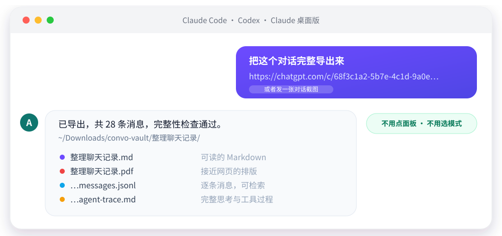
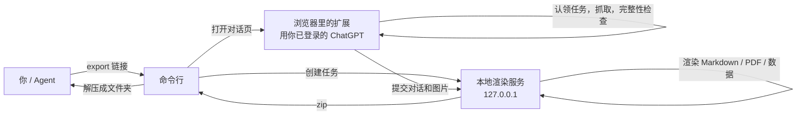

<p align="center">
  
</p>

<p align="center">
  
  
  
  <a href="LICENSE"></a>
  
</p>

<p align="center">
  <a href="README.md">English</a> · 简体中文
</p>

<p align="center">
  <a href="#快速开始">快速开始</a> ·
  <a href="#它能做什么">它能做什么</a> ·
  <a href="#导出的内容">导出的内容</a> ·
  <a href="#命令行">命令行</a> ·
  <a href="#安全与隐私">安全与隐私</a> ·
  <a href="CHANGELOG.zh-CN.md">更新日志</a>
</p>

当前版本：`0.15.0`

一段重要的 ChatGPT 长对话里，常常混着代码、表格、图片、文件和一大段思考过程。手动复制太痛苦，丢给在线转换工具又不放心。

Convo Vault 在你自己的电脑上，把对话导出成一个文件夹：排好版的 Markdown 和 PDF，加上能直接交给 Codex、Claude、Cursor、知识库或 RAG 流程的结构化数据。你只需要对 Agent 说一句话，或者发一张对话截图。

<p align="center">
  
</p>

## 它能做什么

<table>
  <tr>
    <td width="33%" valign="top">
      <h3>对 Agent 说话</h3>
      在 Claude 或 Codex 里贴链接或发截图，它自己打开页面、导出、整理好文件夹。不用点面板，不用选 Fast 或 Full。
    </td>
    <td width="33%" valign="top">
      <h3>内容不丢</h3>
      以 ChatGPT 接口的消息清单为准逐条核对，缺一条就拒绝导出并说明原因。图片、引用、思考过程、生成式界面都保留。
    </td>
    <td width="33%" valign="top">
      <h3>全部在本机</h3>
      渲染服务只监听 <code>127.0.0.1</code>，不用任何在线转换服务。你的 Cookie、令牌和密码不会交给 Agent。
    </td>
  </tr>
</table>

## 快速开始

### 一、让 Agent 替你装

在 Claude Code、Claude 桌面版的 Code 标签或 Codex 里发这一句：

```text
请帮我安装 https://github.com/amethyst-cosmos/convo-vault ，按仓库里的 INSTALL.md 操作（有中文版 INSTALL.zh-CN.md），装到 ~/convo-vault。
```

Agent 会克隆项目、安装依赖、构建扩展、安装 skill，并运行检查。

### 二、在浏览器里加载一次扩展

这是唯一需要你动手的一步，浏览器不允许程序自动安装未上架的扩展：

1. 打开扩展页面（`chrome://extensions` 或 `edge://extensions`），开启右上角“开发者模式”
2. 点“加载已解压的扩展程序”，选择 `~/convo-vault/dist/convo-vault-extension`
3. 在这个浏览器里登录 ChatGPT

### 三、开始用

重开一个会话，然后说：

> 把这个对话导出来：https://chatgpt.com/c/xxxxxxxx-xxxx-xxxx-xxxx-xxxxxxxxxxxx

或者发一张对话截图，说“帮我把这段对话完整下载下来”。Agent 会从截图的地址栏读出链接。导出的文件夹在 `~/Downloads/convo-vault/`。

<details>
<summary><b>不想让 Agent 装？手动安装</b></summary>

<br>

从 [Releases](https://github.com/amethyst-cosmos/convo-vault/releases) 下载 `convo-vault-<版本>.zip` 解压，或者克隆仓库，然后：

```bash
node cli/convo-vault.mjs setup     # 装依赖、构建扩展、安装 skill，并打开扩展页面
node cli/convo-vault.mjs verify    # 加载扩展后运行，确认浏览器里的扩展有响应
```

需要 Node 20 或更新版本。

</details>

### 哪些环境能用

| 环境 | 支持 | 方式 |
| --- | :---: | --- |
| Claude Code、Claude 桌面版的 Code 标签、Codex | ✅ | skill，`setup` 自动安装 |
| Claude 桌面版的普通聊天、Cursor 等支持本地 MCP 的客户端 | ✅ | `node cli/convo-vault.mjs mcp install`，在聊天里发链接或截图 |
| claude.ai 网页、ChatGPT 网页（含 Agent 模式） | ❌ | 它们跑在云端沙盒里，碰不到你电脑上的浏览器和本地服务 |

## 它是怎么做到不用点的



- 命令行在本地渲染服务里创建一个任务，再打开 `chatgpt.com/c/<id>#convo-vault-job=<任务 id>`
- 扩展认领任务，用页面里已登录的会话抓取对话，通过完整性检查后交给渲染服务，完成后自动关掉标签页
- 抓取不完整时任务会失败并说明缺了什么，不会静默导出残缺内容

skill 是自成一体的文件夹 `skills/convo-vault-skill`，可以复制到任何地方，或运行 `node cli/convo-vault.mjs skill install --dir <文件夹>`。它自带的启动脚本会自己找到项目，第一次用时自动从 GitHub 安装。

### 也可以在 Agensi 上找到

同一个 skill 已免费上架 [Agensi](https://www.agensi.io/skills/convo-vault-chatgpt-exporter)，这是一个通过 MCP 把 skill 交给 Agent 的市场。上架的是纯文字版（`skills/convo-vault-agensi`）：第一次使用时 Agent 会先征求你的同意，再把本项目从 GitHub 安装到 `~/convo-vault`，你只需要加载一次扩展。两种方式用的是同一份开源代码，Agensi 只是多一个找到它的入口。

### Grok

Grok 的对话用法一样：把 `https://grok.com/c/<id>` 链接给 Agent，或运行 `node cli/convo-vault.mjs export https://grok.com/c/<id>`。扩展用浏览器里已登录的会话读取 Grok 自己的对话接口（不要令牌、不滚动页面），导出前核对每条消息是否都取回。PDF 和数据文件的样式和 ChatGPT 的导出一致，只是名称标成 Grok；Grok 的搜索步骤成为思考记录，引用变成脚注。

图片（Grok 生成的和你上传的）会下载进导出包；其他附件只列出名称。Grok 暂不支持：下载附件、`list` 和 `--project`。有重新生成的回答时导出最新的分支，并说明跳过了几个备选回答。多个 Grok 链接在同一个 grok.com 标签页里依次导出，ChatGPT 和 Grok 的链接混在一起时每个网站一个标签页。

### Gemini

Gemini 的对话也可以：把 `https://gemini.google.com/app/<id>` 链接给 Agent。Gemini 没有扩展能调用的对话接口，所以读的是页面本身：扩展把对话滚到最上面，直到不再出现更早的内容，再把每条回答的 HTML 还原成 Markdown（列表、表格、带语言的代码、公式、链接），导出同样的导出包，名称标成 Gemini。多个 Gemini 链接各开一个标签页，依次导出。

如实说明的限制：Gemini 不告诉你一个对话有多少条消息，所以核对只能看页面上显示的内容（每个提问都有回答、没有还在生成的回答、加载时没有丢轮次），导出时会用警告说明。图片（包括 Gemini 生成的）会从页面里读出来嵌进导出包；如果页面不让脚本读取某张图，它会以链接出现，导出时会说明有几张。折叠的思考面板、来源标签和附件不会导出（页面上有附件名时会列出名称）。这是三个网站里最脆弱的一个：Gemini 改版就可能失效。

## 导出的内容

每次导出得到一个文件夹，同时保留 `.zip`。

| 文件 | 内容 |
| --- | --- |
| `*.md` | 可读的 Markdown 档案，引用是可点击的脚注 |
| `*.pdf` | 本地渲染的 PDF，排版接近 ChatGPT 页面；生成式界面、公式、Mermaid、图表都静态绘制 |
| `*.summary.md` | 摘要索引 |
| `*.messages.jsonl` | 逐条消息，适合检索和 RAG |
| `*.qa-pairs.json` | 问答配对 |
| `*.topics.json`、`*.entities.json` | 话题索引；链接、文件名、日期等实体线索 |
| `*.agent-trace.json` | 完整思考过程：每个回答从提问到作答之间的思考摘要、工具调用和完整返回内容，按时间排序，附来源索引 |
| `*.agent-trace.md` | 同一份记录的可读版，长输出截断并指向 JSON |
| `*.assets.manifest.json` | 图片和附件的来源、存储方式与降级原因；已下载文件的大小和 SHA-256 |
| `assets/files/` | 仅 `--files` 时有：对话里上传和生成的 Word、PDF、zip 等文件 |
| `*.payload.json`、`*.conversation.json`、`*.data.json` | 完整导出数据和对话元数据，可用于重新渲染 |

## 命令行

```bash
node cli/convo-vault.mjs export https://chatgpt.com/c/<id>         # 链接或对话 id 都行
node cli/convo-vault.mjs export <链接> --out ./archive             # 指定保存位置
node cli/convo-vault.mjs export <链接> --browser "Microsoft Edge"
node cli/convo-vault.mjs export <链接1> <链接2> <链接3>             # 一次导出多个，只开一个浏览器标签页
node cli/convo-vault.mjs list --project "Research"                  # 查看项目里有哪些对话（id、日期、标题）
node cli/convo-vault.mjs export --project "Research"                # 导出项目里的所有对话
node cli/convo-vault.mjs export --project "Research" --files-for "发票,报告"   # 只有标题含“发票”或“报告”的带附件
```

| 命令 | 作用 |
| --- | --- |
| `setup` | 安装依赖、构建扩展、安装 skill |
| `list` | 列出对话（最近的，或 `--project 名称` 里的）；`--json` 输出数据 |
| `verify` | 确认浏览器里的扩展有响应 |
| `doctor` | 自检：依赖、扩展构建、浏览器、skill |
| `update` | 拉取最新版本、重新安装并重新加载扩展（git 克隆） |
| `reload` | 重建后让扩展自己重新加载 |
| `skill install` | 重新安装 Claude 和 Codex 的 skill |
| `mcp install` / `mcp config` | 给 Claude 桌面版聊天安装 MCP；打印其他客户端的配置 |
| `backend start` / `stop` / `status` | 本地渲染服务；导出时自动启动，空闲两分钟后自动退出，不用手动关 |

其他选项：`--files` 同时下载对话里上传和生成的文件（默认不下，Agent 会先问你一次），`--no-pdf` 只导出数据，跳过 PDF（更快，不需要无头 Chrome），`--no-extract` 只要 zip，`--keep-tab` 导出后不关标签页，`--allow-incomplete` 允许导出不完整的抓取（默认拒绝）。第一次导出会依次尝试已安装的 Chrome、Edge、Brave，并记住装了扩展的那个。

## 不用 Agent 时

扩展默认只是一个连接器：导出由 Agent 或命令行发起，弹窗里没有要点的东西。想自己手动导出的话，点浏览器工具栏的 Convo Vault 图标，打开 **Manual controls**（手动控制）。这个选择会被记住，不管开不开，Agent 都照样能发起导出。

打开手动控制后，打开 ChatGPT 对话，按 **Export this conversation**。它会导出整段对话，没有选择消息这一步。需要先启动本地渲染服务：`node cli/convo-vault.mjs backend start`，或在弹窗里点 **Copy Start**。

## 它怎么读取对话

Convo Vault 读的是 ChatGPT 自己的对话接口，也就是页面画出来的那份数据。它不会滚动或点击页面，所以很长的对话几秒就读完，标签页放在后台也行。读完后会按消息 id 对照 ChatGPT 的消息清单，缺任何一条都会拦截并说明。

导出的是对话里有的一切：每条消息、模型的思考步骤和工具调用（按顺序，含完整返回内容）、它看过和引用过的每个网页、图片和生成式界面。上传和生成的文件会列在清单里，只有你要求时才下载（`--files`，Agent 会问一次，默认不下）。留下哪些，由你导出后自己决定。

## 安全与隐私

- 扩展只读取当前打开的 ChatGPT 页面，不使用任何远程转换服务
- PDF、Markdown 和 zip 都在本机生成；运行时数据放在 `.convo-vault/`，不会进 Git
- 渲染服务只监听 `127.0.0.1`，请求要带令牌；没有令牌时，带浏览器 Origin 的请求会被拒绝
- 自动导出任务用 192 位随机 id 标识，只能被扩展认领一次，令牌在认领时直接交给扩展，不经过网页
- 创建任务和读取结果只接受不带浏览器 Origin 的本机请求，并校验 Host，网页和 DNS 重绑定调用不了
- Agent 不需要也拿不到你的 ChatGPT 登录状态，扩展用的是浏览器里已登录的会话

## 多语言与输出类型

对话内容按 Unicode 原文保留：中文、英文、西语、意大利语、日语、韩语、阿拉伯语、希伯来语和混排都能导出，不翻译。

PDF 是给人看的阅读档案，JSON 和资源清单是给机器和恢复用的证据档案。公式、Mermaid、简单图表、代码、表格、图片和 ChatGPT 的生成式界面尽量静态渲染；视频、音频、交互卡片用清晰的卡片降级，并在 JSON 里记录 `kind`、`renderStatus`、`degraded` 和原因，内容不会静默丢失。

## 开发

```bash
npm test                  # 全部测试
npm run check             # 语法与 JSON 校验，并确认内容脚本能构建
npm run build:extension   # 生成 dist/convo-vault-extension 和 zip
npm run package           # 生成 dist/convo-vault-<版本>.zip 发布包
```

- 扩展源码在 `extension/`，内容脚本由 `npm run build:extension` 从 `extension/content/index.js` 和各模块生成，输出到 `dist/convo-vault-extension`
- 发布：运行 `npm run version:set -- X.Y.Z`，它会把版本号写进所有用到它的文件（并在两份 CHANGELOG 里加一个空条目）；补写两份 CHANGELOG，合并后推送 `vX.Y.Z` 标签，GitHub Actions 会检查、测试、打包并创建 Release

## 更新日志

完整历史见 [CHANGELOG.zh-CN.md](CHANGELOG.zh-CN.md)，英文版见 [CHANGELOG.md](CHANGELOG.md)。
