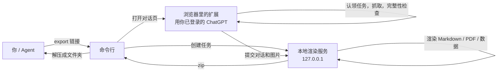

<p align="center">
  
</p>

<p align="center">
  
  
  
  <a href="LICENSE"></a>
  
</p>

<p align="center">
  <a href="README.md">English</a> · 简体中文
</p>

<p align="center">
  <a href="#快速开始">快速开始</a> ·
  <a href="#它能做什么">它能做什么</a> ·
  <a href="#导出的内容">导出的内容</a> ·
  <a href="#命令行">命令行</a> ·
  <a href="#安全与隐私">安全与隐私</a> ·
  <a href="CHANGELOG.zh-CN.md">更新日志</a>
</p>

当前版本：`0.10.3`

一段重要的 ChatGPT 长对话里，常常混着代码、表格、图片、文件和一大段思考过程。手动复制太痛苦，丢给在线转换工具又不放心。

Convo Vault 在你自己的电脑上，把对话导出成一个文件夹：排好版的 Markdown 和 PDF，加上能直接交给 Codex、Claude、Cursor、知识库或 RAG 流程的结构化数据。你只需要对 Agent 说一句话，或者发一张对话截图。

<p align="center">
  
</p>

## 它能做什么

<table>
  <tr>
    <td width="33%" valign="top">
      <h3>对 Agent 说话</h3>
      在 Claude 或 Codex 里贴链接或发截图，它自己打开页面、导出、整理好文件夹。不用点面板，不用选 Fast 或 Full。
    </td>
    <td width="33%" valign="top">
      <h3>内容不丢</h3>
      以 ChatGPT 接口的消息清单为准逐条核对，缺一条就拒绝导出并说明原因。图片、引用、思考过程、生成式界面都保留。
    </td>
    <td width="33%" valign="top">
      <h3>全部在本机</h3>
      渲染服务只监听 <code>127.0.0.1</code>，不用任何在线转换服务。你的 Cookie、令牌和密码不会交给 Agent。
    </td>
  </tr>
</table>

## 快速开始

### 一、让 Agent 替你装

在 Claude Code、Claude 桌面版的 Code 标签或 Codex 里发这一句：

```text
请帮我安装 https://github.com/amethyst-cosmos/convo-vault ，按仓库里的 INSTALL.md 操作（有中文版 INSTALL.zh-CN.md），装到 ~/convo-vault。
```

Agent 会克隆项目、安装依赖、构建扩展、安装 skill，并运行检查。

### 二、在浏览器里加载一次扩展

这是唯一需要你动手的一步，浏览器不允许程序自动安装未上架的扩展：

1. 打开扩展页面（`chrome://extensions` 或 `edge://extensions`），开启右上角“开发者模式”
2. 点“加载已解压的扩展程序”，选择 `~/convo-vault/dist/convo-vault-extension`
3. 在这个浏览器里登录 ChatGPT

### 三、开始用

重开一个会话，然后说：

> 把这个对话导出来：https://chatgpt.com/c/xxxxxxxx-xxxx-xxxx-xxxx-xxxxxxxxxxxx

或者发一张对话截图，说“帮我把这段对话完整下载下来”。Agent 会从截图的地址栏读出链接。导出的文件夹在 `~/Downloads/convo-vault/`。

<details>
<summary><b>不想让 Agent 装？手动安装</b></summary>

<br>

从 [Releases](https://github.com/amethyst-cosmos/convo-vault/releases) 下载 `convo-vault-<版本>.zip` 解压，或者克隆仓库，然后：

```bash
node scripts/convo-vault.mjs setup     # 装依赖、构建扩展、安装 skill，并打开扩展页面
node scripts/convo-vault.mjs verify    # 加载扩展后运行，确认浏览器里的扩展有响应
```

需要 Node 20 或更新版本。

</details>

### 哪些环境能用

| 环境 | 支持 | 方式 |
| --- | :---: | --- |
| Claude Code、Claude 桌面版的 Code 标签、Codex | ✅ | skill，`setup` 自动安装 |
| Claude 桌面版的普通聊天、Cursor 等支持本地 MCP 的客户端 | ✅ | `node scripts/convo-vault.mjs mcp install`，在聊天里发链接或截图 |
| claude.ai 网页、ChatGPT 网页（含 Agent 模式） | ❌ | 它们跑在云端沙盒里，碰不到你电脑上的浏览器和本地服务 |

## 它是怎么做到不用点的



- 命令行在本地渲染服务里创建一个任务，再打开 `chatgpt.com/c/<id>#convo-vault-job=<任务 id>`
- 扩展认领任务，用页面里已登录的会话抓取对话，通过完整性检查后交给渲染服务，完成后自动关掉标签页
- 抓取不完整时任务会失败并说明缺了什么，不会静默导出残缺内容

## 导出的内容

每次导出得到一个文件夹，同时保留 `.zip`。

| 文件 | 内容 |
| --- | --- |
| `*.md` | 可读的 Markdown 档案，引用是可点击的脚注 |
| `*.pdf` | 本地渲染的 PDF，排版接近 ChatGPT 页面；生成式界面、公式、Mermaid、图表都静态绘制 |
| `*.summary.md` | 摘要索引 |
| `*.messages.jsonl` | 逐条消息，适合检索和 RAG |
| `*.qa-pairs.json` | 问答配对 |
| `*.topics.json`、`*.entities.json` | 话题索引；链接、文件名、日期等实体线索 |
| `*.agent-trace.json` | 完整思考过程：每个回答从提问到作答之间的思考摘要、工具调用和完整返回内容，按时间排序，附来源索引 |
| `*.agent-trace.md` | 同一份记录的可读版，长输出截断并指向 JSON |
| `*.assets.manifest.json` | 图片和附件的来源、存储方式与降级原因 |
| `*.payload.json`、`*.conversation.json`、`*.data.json` | 完整导出数据和对话元数据，可用于重新渲染 |

## 命令行

```bash
node scripts/convo-vault.mjs export https://chatgpt.com/c/<id>         # 链接或对话 id 都行
node scripts/convo-vault.mjs export <链接> --out ./archive             # 指定保存位置
node scripts/convo-vault.mjs export <链接> --mode hybrid               # fast（默认）| hybrid | full
node scripts/convo-vault.mjs export <链接> --browser "Microsoft Edge"
```

| 命令 | 作用 |
| --- | --- |
| `setup` | 安装依赖、构建扩展、安装 skill |
| `verify` | 确认浏览器里的扩展有响应 |
| `doctor` | 自检：依赖、扩展构建、浏览器、skill |
| `update` | 拉取最新版本并重新安装（git 克隆） |
| `skill install` | 重新安装 Claude 和 Codex 的 skill |
| `mcp install` / `mcp config` | 给 Claude 桌面版聊天安装 MCP；打印其他客户端的配置 |
| `backend start` / `stop` / `status` | 本地渲染服务；导出时自动启动，空闲两分钟后自动退出，不用手动关 |

其他选项：`--no-pdf` 只导出数据，跳过 PDF（更快，不需要无头 Chrome），`--no-extract` 只要 zip，`--keep-tab` 导出后不关标签页，`--allow-incomplete` 允许导出不完整的抓取（默认拒绝）。第一次导出会依次尝试已安装的 Chrome、Edge、Brave，并记住装了扩展的那个。

## 抓取模式

| 模式 | 数据来源 | 什么时候用 |
| --- | --- | --- |
| **Fast**（默认） | 直接读 ChatGPT 的 conversation API：消息、顺序、图片、思考过程、引用、生成文件，不受虚拟滚动影响，长对话几秒完成 | 日常归档 |
| **Hybrid** | 先 Fast，再用 Full 补页面上才有的细节，按消息 id 合并 | 需要页面额外细节 |
| **Full** | 逐屏滚动页面，要几分钟 | 接口不可用时 |

三种模式都用接口生成“应有消息清单”，按消息 id 核对结果；对不上就判为不完整并阻止导出。

## 手动使用扩展面板

只想导出其中几条消息时，可以不用 Agent：打开 ChatGPT 对话，点浏览器工具栏的 Convo Vault 图标，点 **Open Selector**，选好模式后 **Start Scan**，核对完整性报告再导出。面板方式要先启动渲染服务：运行 `node scripts/convo-vault.mjs backend start`，或在弹窗里点 **Copy Start** 并把命令粘贴到终端。

<table>
  <tr>
    <td align="center" width="50%">
      <br>
      <sub>扩展弹窗：打开选择器，查看渲染服务状态</sub>
    </td>
    <td align="center" width="50%">
      <br>
      <sub>选择消息，核对完整性报告，导出</sub>
    </td>
  </tr>
</table>

<details>
<summary>更多面板截图</summary>

<br>

<p align="center"></p>
<p align="center"></p>
<p align="center"></p>
<p align="center"></p>
<p align="center"></p>

</details>

## 安全与隐私

- 扩展只读取当前打开的 ChatGPT 页面，不使用任何远程转换服务
- PDF、Markdown 和 zip 都在本机生成；运行时数据放在 `.convo-vault/`，不会进 Git
- 渲染服务只监听 `127.0.0.1`，请求要带令牌；没有令牌时，带浏览器 Origin 的请求会被拒绝
- 自动导出任务用 192 位随机 id 标识，只能被扩展认领一次，令牌在认领时直接交给扩展，不经过网页
- 创建任务和读取结果只接受不带浏览器 Origin 的本机请求，并校验 Host，网页和 DNS 重绑定调用不了
- Agent 不需要也拿不到你的 ChatGPT 登录状态，扩展用的是浏览器里已登录的会话

## 多语言与输出类型

对话内容按 Unicode 原文保留：中文、英文、西语、意大利语、日语、韩语、阿拉伯语、希伯来语和混排都能导出，不翻译。

PDF 是给人看的阅读档案，JSON 和资源清单是给机器和恢复用的证据档案。公式、Mermaid、简单图表、代码、表格、图片和 ChatGPT 的生成式界面尽量静态渲染；视频、音频、交互卡片用清晰的卡片降级，并在 JSON 里记录 `kind`、`renderStatus`、`degraded` 和原因，内容不会静默丢失。

## 同类项目对比

下面按各项目公开的 README 或官网整理（2026 年 10 月），有出入欢迎指正。

| | **Convo Vault** | [pionxzh/chatgpt-exporter](https://github.com/pionxzh/chatgpt-exporter) | [ChatGPT Exporter](https://www.chatgptexporter.com/)（Chrome 扩展） | OpenAI 官方导出 + [convoviz](https://github.com/mohamed-chs/convoviz) 等转换器 |
| --- | --- | --- | --- | --- |
| 运行位置 | 本地扩展 + 本地渲染服务 | Tampermonkey 用户脚本 | Chrome 扩展；官网称 PDF 在其服务器上生成 | 官方邮件发 zip，转换器在本地运行 |
| 格式 | Markdown、PDF、JSONL、QA 对、话题、实体、素材清单 | Text、PNG、Markdown、HTML、JSON | PDF、Markdown、TXT、JSON、CSV、图片 | 原始 JSON；convoviz 生成 Markdown、图表、词云 |
| 思考与工具过程 | ✅ 按顺序，含完整工具输出 | README 未列出 | 官网未列出 | convoviz README 未列出 |
| 完整性检查 | ✅ 对照 ChatGPT 的消息清单，缺失即拦截 | 未列出 | 未列出 | 不适用 |
| Agent / 命令行 / MCP | ✅ skill、命令行、MCP | 未列出 | 未列出 | 仅命令行 |
| 导出全部对话 | ❌ 暂未支持 | ✅ Export All | 未列出 | ✅ 全部历史 |
| 安装 | Releases 或 `git clone`，加载一次扩展 | Tampermonkey + 用户脚本 | Chrome 网上应用店 | 无需安装，或 `pip` / `uv` |
| 成熟度 | 新项目 | 2.8k star，2022 年 12 月起持续更新 | 官网称“80,000+ 用户”（自报） | 成熟 |

如果现在就要归档全部历史，请用其他几个。如果要的是重要对话的完整、可交给 Agent 的导出（含思考过程），并且希望直接让 Agent 去做，那就是 Convo Vault 的定位。

## 开发

```bash
npm test                  # 全部测试
npm run check             # 语法与 JSON 校验，并确认 content.js 与 src/content 同步
npm run build:extension   # 生成 dist/convo-vault-extension 和 zip
npm run package           # 生成 dist/convo-vault-<版本>.zip 发布包
```

- `content.js` 由 `src/content/index.js` 加各模块生成，改了 `src/content` 后运行 `npm run build:extension`
- 发布：改版本号后推送 `v<版本>` 标签，GitHub Actions 会检查、测试、打包并创建 Release
- 版本号需要同步：`package.json`、`manifest.json`、`tools/advanced-pdf/package.json`、`src/content/index.js`、`popup.html`、两份 README、两份 CHANGELOG；`tests/version.test.mjs` 会检查

## 更新日志

完整历史见 [CHANGELOG.md](CHANGELOG.zh-CN.md)。

`0.10.3` 英文 README 成为默认，中文版移到 `README.zh-CN.md`；新增 MIT 许可证、安全与贡献说明、同类项目对比。

`0.10.2` 渲染服务空闲后自动退出，不用再手动关；新增 `--no-pdf` 只导出数据（更快，不依赖 Chrome）。

`0.10.1` 重写 README（横幅、演示图、更清晰的安装步骤），修复 Windows 上的 CI 测试。

`0.10.0` 让 Agent 直接导出：新增 `convo-vault` skill（Claude、Codex）、MCP 服务、命令行 `export` / `setup` / `verify`、自动导出任务、一句话安装（`INSTALL.md`）和一键发布包。
